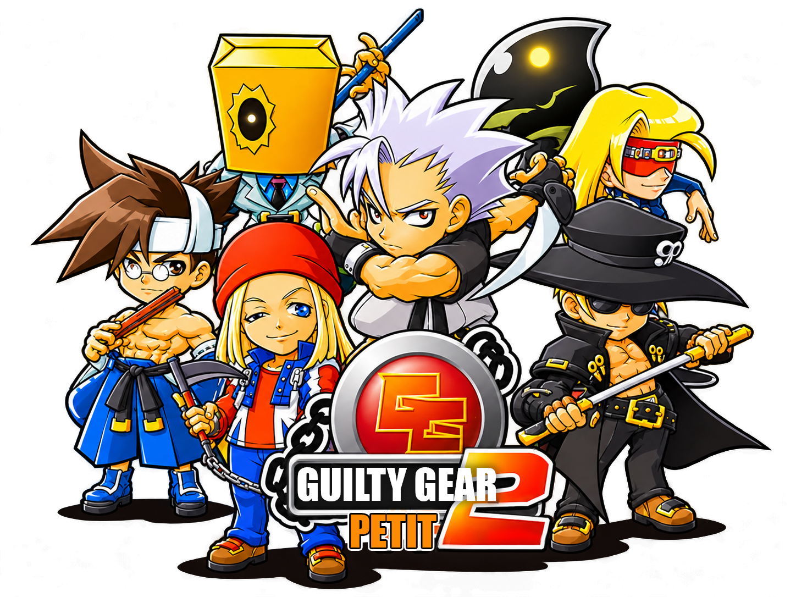
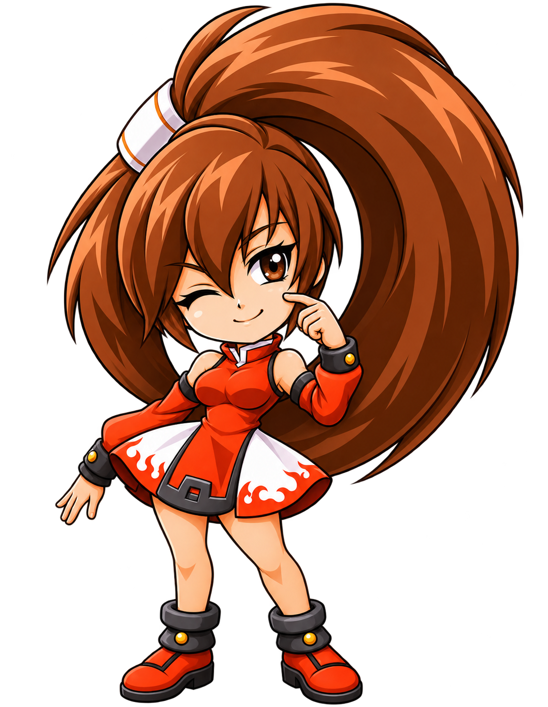

# Guilty Gear Petit 2 — русский перевод 🇷🇺

**Guilty Gear Petit 2** — необычная карманная часть серии файтингов *Guilty Gear*, в которой знакомые персонажи представлены в миниатюрном (*чиби*) стиле. За милой внешностью скрывается файтинг с разнообразными бойцами, специальными приёмами, сюжетными историями и несколькими игровыми режимами.

По большому счёту, эту игру можно воспринимать как фанфик или пародию, ведь большинство историй заставляют улыбаться, а порой и откровенно ржать (лично я от души посмеялся над историями Поти и Джем).

В общем, главная цель перевода — сделать игру понятной русскоязычным игрокам, сохранив забавную атмосферу оригинала, характеры персонажей и узнаваемое оформление. И самое главное — добиться того, чтобы у игрока возникло ощущение, будто перед ним не просто переведённая японская игра, а полноценная РУССКАЯ локализация.

## 📖 Что переведено

Русификация охватывает практически всё текстовое наполнение игры:

- **Сюжетный режим** — все 356 сюжетных страниц, включая вступления, встречи с другими бойцами и концовки.
- **Победные реплики** — все 324 фразы после победы, а также короткие боевые реплики.
- **Режим «Выживание»** — все 33 варианта итоговых сообщений, включая поздравления, награды, подсказки и условия их получения.
- **Списки приёмов** — названия разделов, команды выполнения и пояснения к 184 приёмам, включая обычное и упрощённое управление.
- **Игровой интерфейс** — главное меню, настройки, пауза, тренировка, выбор персонажей, результаты боёв, таблицы рекордов, музыкальный проигрыватель и другие экраны.
- **Режим «На время»** — поздравления, результаты прохождения и обозначения рекордов.
- **Пароли и дополнительные материалы** — подсказки, сообщения Венома, названия открываемых возможностей и элементы галереи.
- **Диалоги Байкен** — дополнительные сообщения после прохождения игры и экраны, связанные с дуэлью.
- **Финальные титры** — должности разработчиков и служебные надписи.

## 🎨 Графика и надписи

Переведены не только текстовые строки, но и многие надписи, выполненные в оригинале как графика. В частности, переработаны логотипы персонажей на экране выбора и крупные боевые заставки:

**ПОБЕДА · ПОРАЖЕНИЕ · СЛЭШ · ИДЕАЛЬНО · ДУЭЛЬ**

Эти элементы оформлены в стилистике игры, с учётом оригинальных цветов и теней.

 

## 🌏 Что сознательно было переведено на АНГЛИЙСКИЙ или не переведено вовсе

| Элемент | Почему не по-русски? |
| --- | --- |
| **Названия специальных приёмов**, например **GUN FLAME**, **VOLCANIC VIPER**, **DRAGON INSTALL** | Любой, кто играл в GG, знает, что такое **GUN FLAME**, и знает его именно под этим названием. Превратить столь знакомый приём в какой-нибудь **ОГНЕННЫЙ ПИСТОЛЕТ** или **ГАН ФЛЕЙМ** — это уже какой-то надмозг и Фаргус. Поэтому названия приёмов переведены на **АНГЛИЙСКИЙ**. При этом команды выполнения и пояснения к ним — на русском. |
| **Обозначения кнопок и направлений** | Чтобы инструкции соответствовали реальному управлению и не путали игрока. В GGP2 нет P, K, S и HS. Нет даже отдельных кнопок ВВЕРХ или ВНИЗ. Есть кнопки X, кнопки Y, а также кнопки A и B. Глифы стрелочек в списках приёмов тоже заботливо оставлены на своих местах. |
| Вертикальные логотипы **Андзи Мито и Курадобери Джем** | Их восточноазиатская письменность — часть художественного образа персонажей. Мне попросту жалко это менять. Имена и реплики в остальных разделах игры, разумеется, переведены. |
| Фразы **HEAVEN OR HELL** и **LET'S ROCK!** | Эти фразы — настоящая визитная карточка серии Guilty Gear. Переводить их на русский — только зря сердить поклонников игры. |
| **Guilty Gear и некоторые собственные имена** | Чтобы сохранить узнаваемость игры и её связь с оригинальной серией. |

**В общем, русская локализация не означает, что абсолютно всё в игре должно быть написано кириллицей. Иногда лучший перевод — это вовремя остановиться и ничего не переводить.**

## ✅ Как проверялся перевод

Работа не ограничивалась редактированием текста. Игра долго и мучительно тестировалось на:

- соответствие русских реплик японскому оригиналу;
- орфографию, пунктуацию и единообразие терминологии;
- переносы строк и читаемость на маленьком экране;
- правильность цветов, теней и размещения надписей;
- отображение интерфейса, сюжетов и боевых заставок в разных игровых ситуациях.

Для проверки использовались эмуляторы WonderSwan, а отдельные элементы испытывались на настоящей консоли **SwanCrystal**.

> **Статус:** перевод и его игровые элементы прошли многочисленные проверки, но финальное тестирование отдельных сценариев ещё продолжается.

## ⚠️ Особенности игры на настоящей приставке

- **Совместимость с Flash Masta.** На [официальном форуме Flash Masta](https://forum.freeplaytech.com/showthread.php?tid=5139) опубликован список игр, имеющих проблемы с этим флеш-картриджем. В него входит Guilty Gear Petit, а у Guilty Gear Petit 2 также обнаружены проблемы с прохождением режима Survival. Впрочем, [энтузиасты выяснили](https://www.reddit.com/r/WonderSwan/comments/v1jjci/), что некоторые из этих проблем исчезают, если записывать игры непосредственно в первый слот, минуя меню. Как один из альтернативных вариантов для настоящей приставки можно использовать китайский флеш-картридж, прошитый с помощью CPLD и меню из моего проекта [**Wonder Swine Flasher**](https://github.com/cjblackace/wonder-swine-flasher). Последние версии меню были специально оптимизированы для Guilty Gear Petit.

- **Скорость игры.** Guilty Gear Petit 2 сама по себе крайне тяжёлая для WonderSwan Color. Как выяснилось из [обсуждения на Reddit](https://www.reddit.com/r/WonderSwan/comments/slfae6/), заметные тормоза наблюдаются даже на оригинальных картриджах! Причём скорость игры может меняться прямо во время боя: например, после попадания по противнику всё внезапно начинает двигаться быстрее. Короче говоря, как это ни парадоксально, в эмуляторах игра зачастую выглядит заметно бодрее, чем на настоящем железе. И это особенность оригинальной игры, а не результат русификации.

---

**Русская локализация — BLACK ACE © 2026**

**Приятной игры!**

*Guilty Gear и связанные с игрой персонажи, названия и материалы принадлежат их правообладателям. Этот перевод — неофициальный фанатский проект.*
